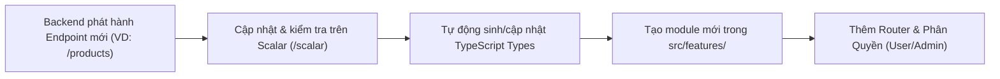

# Tài Liệu Bàn Giao Kỹ Thuật Cho Front-End Developer
**Dự án:** `my-first-api` (NestJS + Supabase + JWT Authentication)  
**Phiên bản API:** `1.0.0`  
**Đối tượng sử dụng:** Front-End Developer / Mobile App Developer  
**Định hướng:** Xây dựng ứng dụng Front-End hoàn chỉnh, bảo mật và thiết kế theo kiến trúc module hóa để sẵn sàng mở rộng tính năng liên tục.

---

## 1. Tổng Quan Hệ Thống & Tài Liệu API Tương Tác

### 1.1. Thông Tin Máy Chủ API
- **Local Development URL:** `http://localhost:3000`
- **Render Production / Staging URL:** `https://<ten-service-render>.onrender.com` (tùy cấu hình deploy trên Render)
- **CORS Support:** Backend đã cấu hình sẵn CORS cho phép credentials (`Authorization`, cookies) và các origin từ `localhost` (`http://localhost:5173`, `http://localhost:3000`, v.v.).
- **Content-Type Mặc Định:** `application/json; charset=utf-8`

### 1.2. Công Cụ Trực Quan Cho Front-End Dev
Backend tích hợp sẵn giao diện trực quan chuẩn OpenAPI:
- **Scalar API Reference (Giao diện hiện đại kiểm thử API trực tiếp):**
  - URL: `http://localhost:3000/scalar` (hoặc `http://localhost:3000/reference`)
  - Chức năng: Đọc chi tiết schema, thử nghiệm gọi request ngay trên trình duyệt, có sẵn nút paste **Bearer Token** để test các route yêu cầu xác thực.
- **OpenAPI Schema (JSON Spec thô):**
  - URL: `http://localhost:3000/openapi.json`
  - Chức năng: Dùng để sinh tự động TypeScript types, TanStack Query hooks bằng các công cụ như `openapi-typescript` hoặc `orval`.

---

## 2. Quy Chuẩn Xác Thực (Authentication & Authorization)

Hệ thống sử dụng cơ chế **JWT (JSON Web Token) Bearer**:
1. Khi `login` hoặc `register` thành công, máy chủ trả về `access_token` có hiệu lực trong vòng **24 giờ**.
2. Với mọi API yêu cầu bảo mật, Front-end cần đính kèm header HTTP:
   ```http
   Authorization: Bearer <access_token>
   ```
3. **Cơ chế Thu hồi Token (Token Blacklist):** Khi người dùng nhấn Đăng xuất (`POST /auth/logout`), token hiện tại sẽ được lưu vào Blacklist trên máy chủ. Kể từ thời điểm đó, nếu tiếp tục gửi token này, API sẽ trả về `401 Unauthorized` ngay cả khi token chưa quá hạn 24 giờ.
4. **Phân quyền Role-based (RBAC):**
   - User có trường `role`: nhận một trong 2 giá trị `'user'` hoặc `'admin'`.
   - Route `GET /users` chỉ cho phép tài khoản có `role === 'admin'`. Người dùng `role === 'user'` truy cập sẽ nhận mã lỗi `403 Forbidden`.

---

## 3. Quy Chuẩn Định Dạng Dữ Liệu & Mã Lỗi HTTP

### 3.1. Các Mã HTTP Status Thường Gặp
- `200 OK`: Yêu cầu thành công, trả về dữ liệu.
- `201 Created`: Tạo mới tài nguyên thành công (Đăng ký tài khoản).
- `400 Bad Request`: Dữ liệu đầu vào không hợp lệ (sai định dạng email, mật khẩu ngắn hơn 6 ký tự...).
- `401 Unauthorized`: Chưa đăng nhập, token sai, token hết hạn hoặc token đã bị đăng xuất (blacklist).
- `403 Forbidden`: Người dùng đã đăng nhập nhưng không đủ quyền hạn (không phải Admin).
- `409 Conflict`: Xung đột dữ liệu (Email đã được đăng ký trước đó).
- `500 Internal Server Error`: Lỗi phát sinh từ máy chủ hoặc cơ sở dữ liệu.
- `503 Service Unavailable`: Dịch vụ phụ thuộc gặp sự cố (Health check cơ sở dữ liệu báo fail).

### 3.2. Cấu Trúc Báo Lỗi Chuẩn Từ Backend
Khi request gặp lỗi, Backend trả về payload JSON có cấu trúc nhất quán:

```json
{
  "statusCode": 400,
  "message": [
    "Email không đúng định dạng",
    "Mật khẩu phải có ít nhất 6 ký tự"
  ],
  "error": "Bad Request"
}
```
*(Lưu ý: Đối với lỗi đơn lẻ như 401 hoặc 409, thuộc tính `message` có thể là chuỗi ký tự đơn `string`, ví dụ: `"Email này đã được sử dụng"`).*

---

## 4. Chi Tiết Danh Sách API Endpoints

### 4.1. Nhóm Xác Thực (`/auth`)

#### 4.1.1. Đăng Ký Tài Khoản Mới
- **Endpoint:** `POST /auth/register`
- **Auth:** Không yêu cầu (Public)
- **Request Body:**
  ```json
  {
    "email": "user@example.com",
    "password": "Password123!",
    "name": "Nguyễn Văn A"
  }
  ```
  - `email`: Chuỗi email hợp lệ (Bắt buộc).
  - `password`: Chuỗi tối thiểu 6 ký tự (Bắt buộc).
  - `name`: Chuỗi không rỗng (Bắt buộc).
- **Phản Hồi Thành Công (`201 Created`):**
  ```json
  {
    "message": "Đăng ký tài khoản thành công",
    "user": {
      "id": "c1f7a68e-9087-43b2-baee-98923a4112df",
      "email": "user@example.com",
      "name": "Nguyễn Văn A",
      "role": "user",
      "createdAt": "2026-11-05T07:15:00.000Z",
      "updatedAt": "2026-11-05T07:15:00.000Z"
    },
    "access_token": "eyJhbGciOiJIUzI1NiIsInR5cCI6IkpXVCJ9...",
    "token_type": "Bearer"
  }
  ```
- **Lỗi Thường Gặp:**
  - `400 Bad Request`: Thiếu dữ liệu hoặc sai định dạng.
  - `409 Conflict`: `{"statusCode": 409, "message": "Email này đã được sử dụng"}`.

---

#### 4.1.2. Đăng Nhập
- **Endpoint:** `POST /auth/login`
- **Auth:** Không yêu cầu (Public)
- **Request Body:**
  ```json
  {
    "email": "user@example.com",
    "password": "Password123!"
  }
  ```
- **Phản Hồi Thành Công (`200 OK`):**
  ```json
  {
    "message": "Đăng nhập thành công",
    "access_token": "eyJhbGciOiJIUzI1NiIsInR5cCI6IkpXVCJ9...",
    "token_type": "Bearer",
    "user": {
      "id": "c1f7a68e-9087-43b2-baee-98923a4112df",
      "email": "user@example.com",
      "name": "Nguyễn Văn A",
      "role": "user",
      "createdAt": "2026-11-05T07:15:00.000Z",
      "updatedAt": "2026-11-05T07:15:00.000Z"
    }
  }
  ```
- **Lỗi Thường Gặp:**
  - `401 Unauthorized`: `{"statusCode": 401, "message": "Email hoặc mật khẩu không chính xác"}`.

---

#### 4.1.3. Lấy Thông Tin Người Dùng Hiện Tại (Profile / Me)
- **Endpoint:** `GET /auth/profile` hoặc `GET /auth/me`
- **Auth:** `Bearer Token` (Bắt buộc)
- **Header:** `Authorization: Bearer <access_token>`
- **Phản Hồi Thành Công (`200 OK`):**
  ```json
  {
    "id": "c1f7a68e-9087-43b2-baee-98923a4112df",
    "email": "user@example.com",
    "name": "Nguyễn Văn A",
    "role": "user",
    "createdAt": "2026-11-05T07:15:00.000Z",
    "updatedAt": "2026-11-05T07:15:00.000Z"
  }
  ```
- **Lỗi Thường Gặp:**
  - `401 Unauthorized`: Token không truyền, hết hạn, hoặc bị vô hiệu hóa.

---

#### 4.1.4. Đăng Xuất (Revoke Token)
- **Endpoint:** `POST /auth/logout`
- **Auth:** `Bearer Token` (Bắt buộc)
- **Header:** `Authorization: Bearer <access_token>`
- **Phản Hồi Thành Công (`200 OK`):**
  ```json
  {
    "message": "Đăng xuất thành công"
  }
  ```
- **Xử lý phía Front-End:**
  - Gọi API này để báo server đưa token vào Blacklist.
  - Xóa token khỏi `localStorage` / `sessionStorage` / Cookies và chuyển hướng người dùng về màn hình Đăng nhập.

---

### 4.2. Nhóm Quản Trị Người Dùng (`/users` hoặc `/admin/users`)

#### 4.2.1. Lấy Danh Sách Toàn Bộ Người Dùng (Chỉ Dành Cho Admin)
- **Endpoint:** `GET /users` (hoặc alias `GET /admin/users`)
- **Auth:** `Bearer Token` (Yêu cầu `role: "admin"`)
- **Header:** `Authorization: Bearer <ADMIN_ACCESS_TOKEN>`
- **Phản Hồi Thành Công (`200 OK`):** Trả về mảng danh sách người dùng (mật khẩu đã được loại trừ an toàn):
  ```json
  [
    {
      "id": "admin-uuid-001",
      "email": "admin@example.com",
      "name": "System Administrator",
      "role": "admin",
      "createdAt": "2026-11-05T00:00:00.000Z",
      "updatedAt": "2026-11-05T00:00:00.000Z"
    },
    {
      "id": "c1f7a68e-9087-43b2-baee-98923a4112df",
      "email": "user@example.com",
      "name": "Nguyễn Văn A",
      "role": "user",
      "createdAt": "2026-11-05T07:15:00.000Z",
      "updatedAt": "2026-11-05T07:15:00.000Z"
    }
  ]
  ```
- **Lỗi Thường Gặp:**
  - `401 Unauthorized`: Chưa truyền token hoặc token không hợp lệ.
  - `403 Forbidden`: Tài khoản không có cờ admin (`role !== 'admin'`).

---

### 4.3. Nhóm Kiểm Tra Sức Khỏe Hệ Thống (`/health`)

Thích hợp để Front-End hiển thị một **System Health Widget / Dashboard** kiểm tra trạng thái Backend trong trang cài đặt hoặc trang Admin:
- `GET /health` (hoặc `GET /healthz`): Kiểm tra toàn diện (Uptime, Memory heap, Supabase Database latency). Trả về chuẩn IETF `Content-Type: application/health+json`.
- `GET /health/live`: Liveness probe (kiểm tra tiến trình Node.js).
- `GET /health/ready`: Readiness probe (kiểm tra sẵn sàng của kết nối Supabase).

---

## 5. TypeScript Contract (Sử Dụng Trực Tiếp Phía Front-End)

Tạo file `src/types/api.ts` trên dự án Front-End và paste trực tiếp định nghĩa types này:

```typescript
// src/types/api.ts

export type UserRole = 'admin' | 'user';

export interface User {
  id: string;
  email: string;
  name: string;
  role: UserRole;
  createdAt: string;
  updatedAt: string;
}

export interface AuthResponse {
  message: string;
  access_token: string;
  token_type: 'Bearer';
  user: User;
}

export interface LogoutResponse {
  message: string;
}

export interface ApiErrorResponse {
  statusCode: number;
  message: string | string[];
  error?: string;
}

export interface HealthCheckItem {
  componentId: string;
  componentType: string;
  status: 'pass' | 'warn' | 'fail';
  observedValue?: number | string;
  observedUnit?: string;
  time: string;
  output?: string;
}

export interface HealthResponse {
  status: 'pass' | 'warn' | 'fail';
  version: string;
  releaseId: string;
  notes?: string[];
  serviceId: string;
  description: string;
  checks: Record<string, HealthCheckItem[]>;
  links?: Record<string, string>;
}
```

---

## 6. Đề Xuất Cấu Trúc Mã Nguồn Front-End (Feature-Driven Architecture)

Để dự án Front-End có thể dễ dàng mở rộng khi team phát triển thêm nhiều chức năng mới (sản phẩm, thanh toán, thông báo, báo cáo, quản lý phân quyền...), khuyến nghị cấu trúc thư mục dạng **Feature-based / Domain-driven**:

```text
frontend-app/
├── src/
│   ├── api/                     # Cấu hình HTTP client & interceptors dùng chung
│   │   ├── client.ts            # Axios / Fetch instance gốc
│   │   └── endpoints.ts         # Danh sách URL hằng số
│   ├── assets/                  # Hình ảnh, icons, styles tổng
│   ├── components/              # Các UI component dùng chung tái sử dụng
│   │   ├── common/              # Button, Input, Modal, Toast, Table, Spinner
│   │   └── layout/              # Header, Sidebar, Footer, AdminLayout, MainLayout
│   ├── contexts/ / stores/      # Quản lý State toàn cục (Zustand / Redux / Context API)
│   │   └── auth.store.ts        # Lưu token, trạng thái đăng nhập, user profile
│   ├── features/                # Từng module tính năng độc lập (Dễ mở rộng)
│   │   ├── auth/                # Module Đăng nhập / Đăng ký
│   │   │   ├── components/      # LoginForm.tsx, RegisterForm.tsx
│   │   │   ├── hooks/           # useLogin.ts, useRegister.ts
│   │   │   ├── services/        # auth.api.ts
│   │   │   └── pages/           # LoginPage.tsx, RegisterPage.tsx
│   │   ├── users/               # Module Quản lý người dùng (Admin)
│   │   │   ├── components/      # UserTable.tsx, UserFilter.tsx
│   │   │   ├── services/        # users.api.ts
│   │   │   └── pages/           # UserListPage.tsx
│   │   ├── health/              # Module Giám sát hệ thống
│   │   │   ├── components/      # HealthStatusBadge.tsx
│   │   │   └── services/        # health.api.ts
│   │   └── [feature_tuong_lai]/ # Khi thêm tính năng mới, chỉ cần tạo folder tương tự tại đây!
│   ├── routes/                  # Định tuyến ứng dụng
│   │   ├── AppRoutes.tsx
│   │   ├── ProtectedRoute.tsx   # Chặn người dùng chưa đăng nhập
│   │   └── AdminRoute.tsx       # Chặn người dùng không có role admin
│   ├── types/                   # TypeScript interfaces & types
│   │   └── api.ts
│   ├── utils/                   # Hàm tiện ích (format ngày tháng, token storage...)
│   │   └── token.ts
│   ├── App.tsx
│   └── main.tsx
├── .env.example
├── package.json
└── tsconfig.json
```

---

## 7. Mẫu Cài Đặt API Client Với Axios & Tự Động Bắt Lỗi (Production-Ready)

### 7.1. Cài đặt `src/api/client.ts`
File này tự động đính kèm `Bearer Token` vào mọi request và xử lý chuyển hướng khi token hết hạn hoặc bị đưa vào blacklist:

```typescript
// src/api/client.ts
import axios, { AxiosError, InternalAxiosRequestConfig } from 'axios';

const BASE_URL = import.meta.env.VITE_API_URL || 'http://localhost:3000';

export const apiClient = axios.create({
  baseURL: BASE_URL,
  headers: {
    'Content-Type': 'application/json',
  },
  timeout: 10000,
});

// Request Interceptor: Tự động đính kèm Token nếu đã đăng nhập
apiClient.interceptors.request.use(
  (config: InternalAxiosRequestConfig) => {
    const token = localStorage.getItem('access_token');
    if (token && config.headers) {
      config.headers.Authorization = `Bearer ${token}`;
    }
    return config;
  },
  (error) => Promise.reject(error),
);

// Response Interceptor: Bắt lỗi 401 (hết hạn / blacklist) và 403 (không đủ quyền)
apiClient.interceptors.response.use(
  (response) => response,
  (error: AxiosError<{ message?: string | string[]; error?: string }>) => {
    if (error.response) {
      const status = error.response.status;

      // 401 Unauthorized: Token không hợp lệ hoặc đã bị revoke/logout
      if (status === 401) {
        localStorage.removeItem('access_token');
        localStorage.removeItem('user_info');
        // Không redirect nếu đang ở các trang login/register
        if (!window.location.pathname.includes('/login') && !window.location.pathname.includes('/register')) {
          window.location.href = '/login?expired=true';
        }
      }

      // 403 Forbidden: Không đủ quyền truy cập (Ví dụ user thường vào trang admin)
      if (status === 403) {
        console.warn('Bạn không có quyền truy cập chức năng này.');
      }
    }
    return Promise.reject(error);
  },
);
```

### 7.2. Mẫu Service Gọi API Auth (`src/features/auth/services/auth.api.ts`)

```typescript
// src/features/auth/services/auth.api.ts
import { apiClient } from '../../../api/client';
import { AuthResponse, LogoutResponse, User } from '../../../types/api';

export const authApi = {
  login: async (email: string, password: string): Promise<AuthResponse> => {
    const res = await apiClient.post<AuthResponse>('/auth/login', { email, password });
    return res.data;
  },

  register: async (email: string, password: string, name: string): Promise<AuthResponse> => {
    const res = await apiClient.post<AuthResponse>('/auth/register', { email, password, name });
    return res.data;
  },

  getProfile: async (): Promise<User> => {
    const res = await apiClient.get<User>('/auth/me');
    return res.data;
  },

  logout: async (): Promise<LogoutResponse> => {
    const res = await apiClient.post<LogoutResponse>('/auth/logout');
    return res.data;
  },
};
```

### 7.3. Mẫu Service Quản Lý User Dành Cho Admin (`src/features/users/services/users.api.ts`)

```typescript
// src/features/users/services/users.api.ts
import { apiClient } from '../../../api/client';
import { User } from '../../../types/api';

export const usersApi = {
  getAllUsers: async (): Promise<User[]> => {
    const res = await apiClient.get<User[]>('/users');
    return res.data;
  },
};
```

---

## 8. Hướng Dẫn Bảo Vệ Tuyến Đường (Route Guards)

Trong React Router v6 / Next.js / Vue Router, Front-end cần thiết lập 2 tầng bảo vệ:

### 8.1. `ProtectedRoute` (Yêu cầu đăng nhập)
```tsx
// src/routes/ProtectedRoute.tsx
import { Navigate, Outlet } from 'react-router-dom';

export const ProtectedRoute = () => {
  const token = localStorage.getItem('access_token');
  if (!token) {
    return <Navigate to="/login" replace />;
  }
  return <Outlet />;
};
```

### 8.2. `AdminRoute` (Yêu cầu quyền Quản trị viên)
```tsx
// src/routes/AdminRoute.tsx
import { Navigate, Outlet } from 'react-router-dom';
import { User } from '../types/api';

export const AdminRoute = () => {
  const token = localStorage.getItem('access_token');
  const userJson = localStorage.getItem('user_info');
  const user: User | null = userJson ? JSON.parse(userJson) : null;

  if (!token) {
    return <Navigate to="/login" replace />;
  }

  if (user?.role !== 'admin') {
    return <Navigate to="/unauthorized" replace />;
  }

  return <Outlet />;
};
```

---

## 9. Hướng Dẫn Quy Trình Tiếp Tục Mở Rộng Tính Năng (Extensibility Workflow)

Khi Backend tiếp tục phát triển thêm các tính năng trong tương lai (Ví dụ: `products`, `orders`, `categories`, `audit-logs`), Front-End Dev chỉ cần tuân thủ quy trình 4 bước chuẩn hóa sau:



1. **Bước 1: Tra cứu Endpoint mới trên Scalar**
   - Truy cập `http://localhost:3000/scalar` để xem Swagger UI của endpoint mới, cấu trúc request/response, validation rules và mã status code.
2. **Bước 2: Tự động cập nhật TypeScript Types (Tùy chọn khuyến nghị)**
   - Bạn có thể dùng `openapi-typescript` để sinh mã type chuẩn 100% tự động từ API:
     ```bash
     npx openapi-typescript http://localhost:3000/openapi.json -o src/types/schema.ts
     ```
   - Điều này giúp loại bỏ hoàn toàn việc gõ types thủ công và tránh lệch kiểu dữ liệu giữa Front-End và Back-End.
3. **Bước 3: Thêm feature mới vào `src/features/<feature-name>/`**
   - Tạo thư mục `src/features/<feature-name>/` chứa:
     - `services/<feature-name>.api.ts`: Các hàm gọi API thông qua `apiClient`.
     - `hooks/`: Các custom hook hoặc React Query (`useQuery`, `useMutation`).
     - `components/` & `pages/`: Giao diện tương ứng.
4. **Bước 4: Cấu hình Navigation & Phân quyền trên UI**
   - Nếu tính năng chỉ dành cho Admin, bọc route trong `<AdminRoute />`.
   - Trong Header/Sidebar, sử dụng cờ `user?.role === 'admin'` để ẩn/hiện menu điều hướng tương ứng.

---

## 10. Thông Tin Môi Trường & Tài Khoản Kiểm Thử (Test Credentials)

### 10.1. Tài Khoản Admin Có Sẵn (Đã Seed)
Backend đã hỗ trợ script seed sẵn tài khoản Admin vào hệ thống:
- **Email:** `admin@example.com`
- **Mật khẩu:** `Admin@123456`
- **Role:** `admin`

*(Lưu ý: Nếu cần reset hoặc khởi tạo lại dữ liệu mẫu, có thể chạy lệnh `npm run seed` trong thư mục backend).*

### 10.2. Các Kịch Bản Kiểm Thử (User Acceptance Test Cases Cho Front-End)
1. **Kịch bản 1: Đăng ký & Đăng nhập người dùng thông thường**
   - Vào trang Đăng ký -> Nhập email mới, tên và mật khẩu >= 6 ký tự.
   - Kỳ vọng: Nhận `access_token` và chuyển thẳng vào Dashboard hoặc trang Profile.
2. **Kịch bản 2: Kiểm tra Phân quyền User thường**
   - Dùng tài khoản người dùng thường vừa tạo truy cập trang Quản lý User (`/admin/users`).
   - Kỳ vọng: Nhận lỗi `403 Forbidden`, giao diện hiển thị thông báo "Bạn không có quyền truy cập".
3. **Kịch bản 3: Đăng nhập Admin & Quản lý User**
   - Đăng nhập với `admin@example.com` / `Admin@123456`.
   - Truy cập trang Quản lý User (`GET /users`).
   - Kỳ vọng: Hiển thị bảng danh sách đầy đủ các người dùng đã đăng ký.
4. **Kịch bản 4: Đăng xuất & Kiểm tra Token Blacklist**
   - Nhấn nút Đăng xuất -> Gọi `POST /auth/logout`.
   - Kỳ vọng: Backend thu hồi token. Nếu reload trang hoặc cố tình gửi request với token cũ, nhận `401 Unauthorized` và bị redirect về `/login`.
